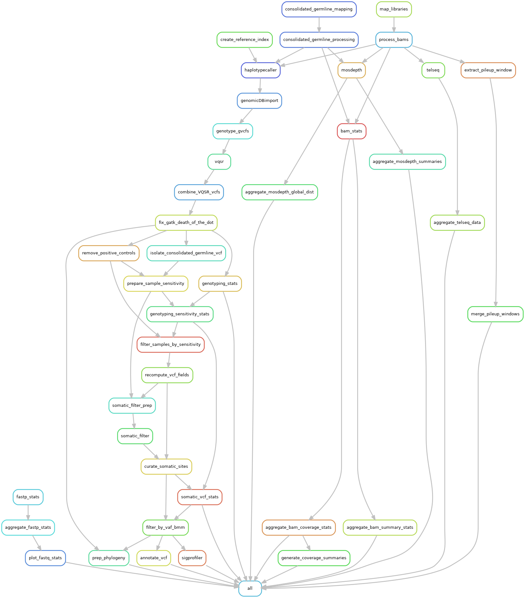

# Processing clone-based WGS data

This directory contains the workflow for processing single-cell based whole-genome sequence data, ultimately producing a multi-sample somatic VCF that captures somatic variation across many hematopoietic lineages from one individual.

---

### Prerequisites

The [`snakemake_env.yaml`](snakemake_env.yaml) file contains an Anaconda environment definition that can be used to recreate a Snakemake version 7 environment. Newer versions of Snakemake will work with this pipeline; this YAML is included for transparency/reproducibility. Additionally, the environments in [`workflow/envs`](workflow/envs/) will automatically be install upon execution of the snakemake pipeline.

Additional data pre-requisites are required to run this workflow and are oulined in the *references* level of [`config_template.yaml`](config_template.yaml). These are:
- The GRCh38 human genome assembly (available [here](https://gdc.cancer.gov/about-data/gdc-data-processing/gdc-reference-files))
- [GATK VQSR](https://gatk.broadinstitute.org/hc/en-us/articles/360035531612-Variant-Quality-Score-Recalibration-VQSR) resource bundle files (available [here](https://gatk.broadinstitute.org/hc/en-us/articles/360035890811-Resource-bundle))
- gnomAD VCF, filtered to only variants with AF ≥ 0.01 (available [here](https://gnomad.broadinstitute.org/downloads))
- 1KGP genome accessibility mask containing genomic regions of poor accessibility via short-read sequencing. **Note that the workflow assumes this workflow assumes the accessiblity mask contains regions of poor accessibility, not good accessibility.** (available [here](https://www.internationalgenome.org/announcements/genome-accessibility-masks/))
- [GATK Funcotator](https://gatk.broadinstitute.org/hc/en-us/articles/360037224432-Funcotator) resource bundle for somatic annotations (available [here](gs://broad-public-datasets/funcotator/))

### Usage

With all prerequisites obtained, configure the values in [`config_template.yaml`] to conform to your workplace's organization. The following keys will need their values updated:
- *input*: 
  - *individual*: **String** used for file naming (e.g., `"IndividualA"`)
  - *directory*: **String** for directory containing all sequence data to be processed (e.g., `"/path/to/seq_proj"`).
  - *libraries*: **List** of unique sample IDs (**string**) corresponding to unique samples, including matched normals (e.g., `["sample1","sample2","sample3","germ1","germ2"]`). If sequencing project included a positive-control (e.g., 1KGP sample), exclude from this list.
  - *germline_libraries*: **List** of matched normal IDs (**string**; e.g., `["germ1","germ2"]).
- *output_dir*: **String** for output directory (e.g., `"/path/to/output_dir"`)
- *references*: Path (**string**) to all prerequisite resources (e.g., `"/path/to/grch38.fa"`)
  - ...

The remaining elements of the YAML contain computational resource parameters (i.e., memory and threads per executable) that can be adjusted freely.

Once prequisites and config have been updated, the workflow can be minimally initiated from the with the following command:
```
snakemake --configfile /path/to/config.yaml --use-conda
```

This command will call the parent [`Snakefile`](workflow/Snakefile) which subsequently includes the data processing [snakefile](workflow/rules/map_clones.smk). 

### Scripts

The [`workflow/scripts/`](workflow/scripts) directory contains all scripts required for the [`map_clones.smk`](workflow/rules/map_clones.smk) rules. All scripts are included in `input` directives within [`map_clones.smk`](workflow/rules/map_clones.smk), so the pipeline will not initialize without first confirming they're present.

Additionally, the [`workflow/scripts/companion_scripts/`](workflow/scripts/companion_scripts/) subdirectory contains additional functions used for phylogenetic inference preparation/execution.


### `doc` directory

The [`doc/`](doc/) directory contains a notebook detailing the results from residualizing telomere length and clock-like mutation burden estimates by binned depth profiles across each sample. 

### Rulegraph


